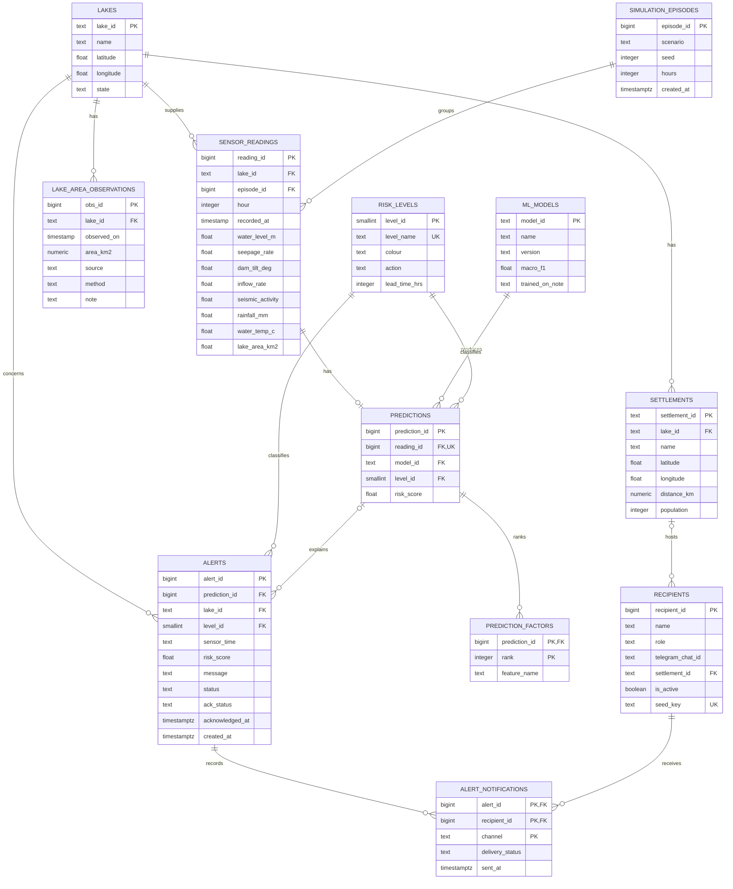

# Entity relationship diagram

Open the [rendered SVG](02_er_diagram.svg) for the full-size diagram. It shows the logical model. The view and import ledger are described in [the schema notes](04_schema.md). The SQL schema defines all attributes and constraints.



Alerts and recipients have a many-to-many relationship through `alert_notifications`. Prediction references are optional so manual alerts and retained historical alerts can exist independently. To export an image with Mermaid CLI, extract the fenced source with `sed -n '/^```mermaid$/,/^```$/p' DE/02_er_diagram.md | sed '1d;$d' > /tmp/warning-er.mmd`, then run `mmdc -i /tmp/warning-er.mmd -o DE/02_er_diagram.svg`.
