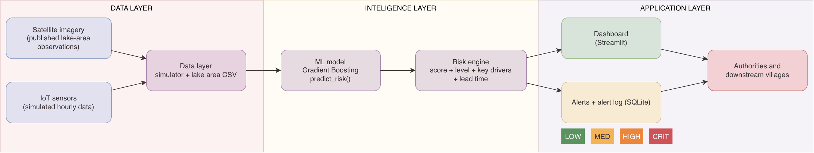

# GLOF Early Warning System

A software prototype of an early warning workflow for Glacial Lake Outburst Floods (GLOFs), using **South Lhonak Lake, Sikkim** as its case study.

## Live demo

**Open the dashboard:** https://warning-system-pc63ffcgfdj5jhm2gfe2an.streamlit.app/

If the page says the app is asleep, click the wake-up button and wait a minute. All sensor data in the demo is **simulated**.

## Get alerts on your phone (step by step)

The dashboard sends alerts as push notifications through [ntfy](https://ntfy.sh), a free service that needs no account.

1. **Install the ntfy app** on your phone: search for "ntfy" in the App Store (iPhone) or Google Play (Android).
2. **Subscribe to the topic.** Open the app, tap **+**, type exactly `GLOF-EWS` (capital letters, with the hyphen), keep the default server `ntfy.sh`, and tap **Subscribe**.
3. **Allow notifications** when your phone asks. If you missed it, switch notifications on for ntfy in your phone's settings.
4. **Open the live dashboard** (link above).
5. **Send a test alert.** In the sidebar choose **Alerts Log** and click **Send test alert**. A red CRITICAL alert should arrive on your phone within a few seconds.
6. **Watch a real escalation.** In the sidebar choose **Live Monitor**, set the scenario to **GLOF precursor (South Lhonak-like)**, keep seed `7`, drag the **Current hour** slider close to `0`, and click **Play from this hour**. As the simulated lake gets more dangerous, you receive a notification each time the risk level rises (MEDIUM, HIGH, CRITICAL).
7. **Check the log.** The **Alerts Log** page lists every alert, with its time, level, score and delivery status (`Push sent (ntfy)` means it was sent).

**When do alerts fire?** An alert needs the risk level to stay at MEDIUM or higher for 2 consecutive hours, and is sent again only when the level rises (or every 12 hours while it stays HIGH or CRITICAL). A single noisy reading does not trigger an alert. If nothing arrives, restart the scenario from an early hour: if the level is already CRITICAL there is nothing new to report.

**Not receiving anything?**
- Check that the topic is spelled exactly `GLOF-EWS`. Topic names are case-sensitive.
- Test your phone without the dashboard. In a terminal run `curl -d "test" ntfy.sh/GLOF-EWS`. If this arrives, your phone is fine.
- Check the **status** column in the Alerts Log. `Preview only (no channel configured)` means the server has no topic set (see "Alert channels" below).

> **Note:** ntfy topics are public. Anyone who subscribes to `GLOF-EWS` sees the demo alerts, and the alerts are simulated. The hosted app's Alerts Log is cleared whenever the app restarts.

## Project status

> The end-to-end prototype is implemented for simulated sensor episodes. The model, alert persistence study, and lake-area inputs are not validated against operational sensor data. The lake-area CSV contains approximate published values; this project has not computed a Sentinel-2 NDWI series. The prototype is not an emergency warning service.

## Documents

- `docs/report.md`: the full project report (also supplied as Word and PDF files).
- `docs/GLOF_EWS_Presentation.pptx`: the presentation.
- `docs/architecture.png`: the system architecture diagram.
- `docs/demo_guide.md`: a walkthrough for demonstrating the dashboard.

## Project overview

A GLOF can occur when a natural moraine or ice dam fails and releases lake water downstream. This project explores a software prototype that uses lake and dam indicators to estimate risk and present information useful for preparedness. The case study is South Lhonak Lake and its October 2023 outburst.

The dashboard displays synthetic episode results and approximate published lake-area observations. It logs alerts to SQLite and can deliver them as ntfy push notifications, Telegram messages or Discord messages when configured. It does not connect to field sensors.

## Objectives

- Generate repeatable hourly sensor scenarios for normal conditions and GLOF precursors.
- Train and evaluate a model that assigns LOW, MEDIUM, HIGH, or CRITICAL risk.
- Present readings, risk estimates, lake-area observations, and alert history in a dashboard.
- Demonstrate alert logging and push-notification delivery.
- Keep the prototype transparent about synthetic data, assumptions, and limitations.

## Features and progress

### Implemented

- `ml/simulator.py` generates seeded hourly synthetic readings for `glof` and `normal` scenarios. GLOF episodes use rain, seepage, or seismic event types; seismic episodes include a weak gradual precursor. Normal episodes include sparse missing readings and spikes by design.
- `ml/train.py` trains a `GradientBoostingClassifier` on 300 generated episodes using a stratified episode-wise 80/20 split: 240 training episodes and 60 held-out episodes. Median imputation is fitted on training rows. `ml/model.pkl` stores the model and its inference metadata.
- `ml/predict.py` provides `predict_risk(reading, history=None)`. Its probability-based `risk_score` is a float in the 0-1 range. The estimated lead time is a fixed per-level approximation: LOW `None`, MEDIUM 36, HIGH 18, CRITICAL 6 hours; it is not separately predicted.
- `ml/predict_stub.py` is a fake threshold-based stand-in for dashboard development. Its outputs are **not model predictions**.
- `ml/evaluate.py` recreates the saved model's held-out split and writes the metrics, confusion matrix, feature-importance plot, event-type recall, warning timing, and false-alarm artifacts in `ml/results/`.
- `ml/alert_rule_study.py` compares alert persistence windows using the same held-out model predictions and writes `alert_persistence.csv` and `alert_persistence.json`.
- `ml/lake_area.py` loads `data/lake_area_south_lhonak.csv` for the dashboard. The CSV contains five approximate published values from NRSC/ISRO radar maps and secondary Planet Labs reporting. They were **not computed by this project from Sentinel-2 NDWI**. See [data/README.md](data/README.md) for source and comparison limitations.
- `app/dashboard.py` provides the Streamlit pages **Overview**, **Live Monitor**, **Lake Growth**, **Alerts Log**, and **Model Performance**. It uses `app/stubs.py` as a fallback for unavailable ML modules and displays a **STUB MODE - outputs are fake, not model predictions** sidebar warning when any stub is used.
- `app/alerts.py` applies two-consecutive-hour persistence by default (`PERSISTENCE_HOURS = 2`, using `effective_level`) before raising dashboard alerts. The alert-repeat rule sends an alert when risk rises above the remembered alerted level, or repeats HIGH/CRITICAL after 12 hours. `app/db.py` logs alert records in SQLite at `app/alerts.db`. Delivery channels are ntfy push (`NTFY_TOPIC`), Telegram (`TG_TOKEN`, `TG_CHAT`) and Discord (`DISCORD_WEBHOOK`); channels that are not configured are skipped and reported as "preview only".
- `ml/check_contract.py` checks the real prediction interface and dashboard stub. `app/check_alert_logic.py` checks alert persistence and repeat behavior without launching Streamlit or accessing the database.

### Planned

- Run and verify Google Earth Engine Sentinel-2 NDWI extraction. `data/extract_lake_area.py` is an **untested skeleton**; its bounding box and water threshold are TODOs for confirmation. No values from the script are in the lake-area CSV.
- Test the Telegram and Discord alert channels live. ntfy push delivery has been tested on a phone.
- Validate the model and the alert rule on real sensor data.

## Technology stack

The pinned Python dependencies in `requirements.txt` are:

- NumPy 2.4.2 and pandas 2.3.3 for synthetic data and tables.
- scikit-learn 1.8.0 for model training and evaluation.
- joblib 1.5.3 for the saved model bundle.
- Streamlit 1.67.0 for the dashboard.
- requests 2.34.2 for alert delivery.
- matplotlib 3.10.8 for evaluation plots.

Python 3.11 or newer is required; the project was developed and tested on Python 3.12.

## Architecture



The repository flow and implementation status:

```text
Synthetic sensor episodes (implemented)
        │
        ├──> Training pipeline (implemented) ──> Saved model (implemented)
        │                                             │
        │                                             v
        └──────────────────────────────────────> Risk prediction (implemented)
                                                      │
Approximate published lake-area CSV (implemented) ───┤
                                                      v
                                        Streamlit dashboard (implemented)
                                                      │
                                    2-hour persistence and alert logging
                                                (implemented)
                                                      │
                                     Alert delivery: ntfy push (tested),
                                     Telegram and Discord (implemented)

Sentinel-2 NDWI extraction (planned; untested skeleton only)
```

## Repository structure

```text
Warning-System/
├── README.md
├── .gitignore
├── check_all.sh                 # Runs all repository checks
├── requirements.txt
├── app/
│   ├── __init__.py
│   ├── alerts.py                # Persistence rule, alert formatting, ntfy / Telegram / Discord delivery
│   ├── check_alert_logic.py     # Pure alert-logic check script
│   ├── dashboard.py             # Streamlit dashboard and its five pages
│   ├── db.py                    # SQLite alert logging and history access
│   └── stubs.py                 # Dashboard fallback functions
├── data/
│   ├── README.md                # Sources and limitations for the area observations
│   ├── extract_lake_area.py     # Untested Earth Engine NDWI skeleton
│   └── lake_area_south_lhonak.csv # Approximate published values; not project-derived NDWI
├── docs/
│   ├── report.md                # Final merged project report
│   ├── GLOF_EWS_Presentation.pptx
│   ├── architecture.png
│   ├── demo_guide.md
│   └── screenshots/             # Dashboard and notification screenshots
└── ml/
    ├── __init__.py
    ├── alert_rule_study.py      # Persistence study on held-out synthetic episodes
    ├── check_contract.py        # Real and stub prediction contract checks
    ├── evaluate.py              # Saved-model held-out evaluation
    ├── lake_area.py             # Published lake-area CSV loader for dashboard
    ├── model.pkl                # Trained synthetic-data model bundle
    ├── predict.py               # Model-backed risk prediction
    ├── predict_stub.py          # Fake dashboard-development predictor
    ├── simulator.py             # Synthetic episodes and multi-episode datasets
    ├── train.py                 # 300-episode model training
    └── results/
        ├── alert_persistence.csv
        ├── alert_persistence.json
        ├── confusion_matrix.png
        ├── false_alarms.json
        ├── feature_importance.png
        ├── metrics.json
        ├── per_event_type_recall.csv
        └── warning_timing.csv
```

## Run locally

Run these commands from the repository root (Python 3.11 or newer):

```bash
python3 -m venv venv
source venv/bin/activate          # on Windows: venv\Scripts\activate
python -m pip install -r requirements.txt
python -m streamlit run app/dashboard.py
```

The dashboard opens at http://localhost:8501. It has five pages: **Overview** (map and current level), **Live Monitor** (scenario, seed, play button, sensor charts, risk timeline, key drivers, lead time), **Lake Growth**, **Alerts Log** and **Model Performance**.

Train or regenerate the model, evaluate it, and run the alert-persistence study (optional, the trained model is already included):

```bash
python -m ml.train
python -m ml.evaluate
python -m ml.alert_rule_study
```

Run all repository checks:

```bash
bash check_all.sh
```

or individually:

```bash
python -m ml.check_contract
python -m ml.check_contract --stub
python -m app.check_alert_logic
```

To generate simulator data or call the predictor from Python:

```python
from ml.predict import predict_risk
from ml.simulator import make_dataset, simulate_episode

glof_episode = simulate_episode(scenario="glof", seed=7, hours=240)
normal_episode = simulate_episode(scenario="normal", seed=7, hours=240)
dataset = make_dataset(n_episodes=100, seed=42, hours=240)

reading = {
    "lake_id": "SL001",
    "timestamp": "2024-08-01T10:00:00",
    "water_level_m": 12.2,
    "seepage_rate": 1.4,
    "dam_tilt_deg": 0.32,
    "inflow_rate": 8.3,
    "seismic_activity": 0.03,
    "rainfall_mm": 2.0,
    "water_temp_c": 3.0,
    "lake_area_km2": 1.31,
}

# Optional history is oldest first. With fewer than six earlier readings,
# the three six-hour change features default to 0.0.
result = predict_risk(reading)
print(result["risk_score"])  # float from 0.0 to 1.0
```

## Alert channels

Alert delivery is optional. Channels that are not configured are skipped, and the alert is logged with a "preview only" status.

**Push notifications (ntfy), local run:** install the ntfy app, subscribe to your topic (see the step-by-step guide at the top), then set the topic in the same terminal before starting the dashboard:

```bash
export NTFY_TOPIC="GLOF-EWS"      # Windows PowerShell: $env:NTFY_TOPIC="GLOF-EWS"
python -m streamlit run app/dashboard.py
```

**Push notifications, hosted app (Streamlit Community Cloud):** open the app's **Settings > Secrets**, add the line below, save, and reboot the app:

```toml
NTFY_TOPIC = "GLOF-EWS"
```

**Telegram (optional):** create a bot with @BotFather, send it a message, and set `TG_TOKEN` and `TG_CHAT` (your chat id).

**Discord (optional):** create a channel webhook and set `DISCORD_WEBHOOK` to its URL.

Never commit tokens, webhook URLs or passwords to the repository. ntfy topics are public, so use a hard-to-guess topic name for anything beyond a demo.

## Alert levels

| Level | Colour | Action |
|---|---|---|
| LOW | Green | Normal monitoring |
| MEDIUM | Yellow | Increase monitoring, notify control room |
| HIGH | Orange | Alert authorities, prepare evacuation of downstream villages |
| CRITICAL | Red | Evacuate immediately, notify all downstream settlements and infrastructure |

An alert is raised when the effective level (the minimum predicted level over the last 2 hours) rises above the last alerted level, and it repeats every 12 hours while the level stays HIGH or CRITICAL. All alerts are stored in `app/alerts.db` and shown on the Alerts Log page.

## Evaluation results (synthetic data)

The saved evaluation uses 240 training and 60 held-out episodes (50,874 training rows and 12,371 test rows). On the held-out synthetic episodes, per-class precision/recall is LOW 0.977/0.994, MEDIUM 0.836/0.593, HIGH 0.805/0.836, and CRITICAL 0.953/0.950. Macro precision/recall/F1 is 0.892/0.843/0.863. MEDIUM recall by GLOF event type is rain 0.921, seepage 0.968, and seismic 0.066. The model predicts 21 of 7,200 held-out normal rows above LOW (0.29%). All 30 held-out GLOF episodes received a warning before the event. These are synthetic-data results, not real-world performance.

### Alert persistence (synthetic data)

The values are from `ml/results/alert_persistence.json`. False alerts are total alerts across the 30 held-out normal episodes; GLOF warning counts are episodes with at least one alert before the event.

| k | False alerts on normal episodes | GLOF episodes alerted | First alert lead: median / minimum (hours) | First HIGH lead: median / minimum (hours) |
|---:|---:|---:|---:|---:|
| 1 | 21 | 30/30 | 50 / 21 | 24 / 20 |
| 2 | 0 | 30/30 | 46 / 20 | 22 / 18 |
| 3 | 0 | 30/30 | 43.5 / 17 | 21 / 12 |
| 4 | 0 | 30/30 | 41.5 / 16 | 20 / 9 |

The dashboard uses **k = 2** by default. In this held-out synthetic study, it removed the observed normal-episode false alerts at the cost of a lower median first-alert lead time. This is a trade-off, not a validated operational setting.

## Limitations and safety

- All sensor values generated by `ml/simulator.py` are synthetic and are not measurements from South Lhonak Lake.
- Simulated precursors and labels are assumptions for prototyping; they do not establish a validated GLOF prediction capability.
- The predictor can process a supplied reading, but it is not connected to an operational sensor feed. No project-computed Sentinel-2 NDWI time series exists; the included lake-area observations are approximate published values. NRSC radar observations are not directly comparable to optical NDWI values, and the secondary Planet Labs reports should be checked against their original publication.
- Seismic MEDIUM recall is very low because the simulated seismic trigger occurs only about 10 hours before the event and the earlier precursor is weak. Seismic warnings were late by about 12-26 hours in 9 of 12 held-out seismic episodes. Some first-warning flags come from single-row blips, which is why the alert rule requires persistence over consecutive hours.
- The saved model, metrics, warning timing, and alert-persistence results are based only on synthetic scenarios; they do not demonstrate real-world model performance or validated warning lead time.
- Alerts were tested only with ntfy push notifications in a demo setting. The Telegram and Discord channels are implemented but untested. The prototype must not be used as an emergency warning service.

## Data honesty

- Sensor data is **simulated**, because real labelled GLOF sensor data is extremely scarce.
- Lake-area values are **approximate published observations** (NRSC/ISRO, Planet Labs), not Sentinel-2 NDWI computed by this project.