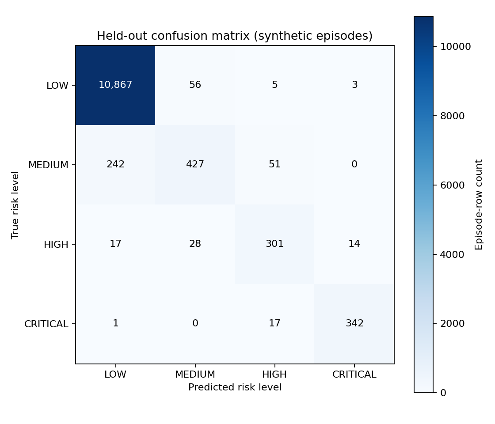
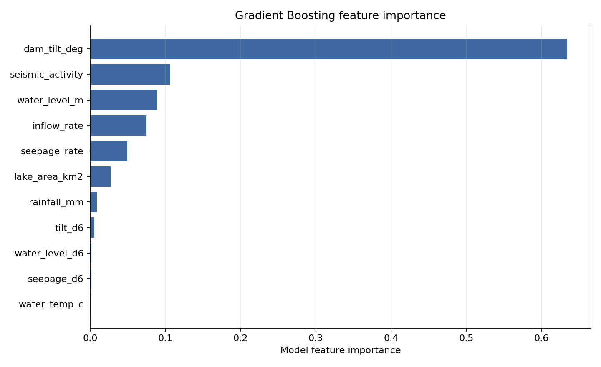

# Member A Report: Data and Machine Learning

## 1. Overview and scope

This report documents the data and machine-learning work for the South Lhonak Lake, Sikkim, GLOF case study. The repository is a software prototype: the simulator generates synthetic readings and event labels, and the trained model and reported metrics are based on those synthetic episodes. The lake-area CSV contains approximate published observations; this project has not computed them from Sentinel-2 NDWI.

The results below describe agreement with the simulator's labels on held-out synthetic episodes. They are not evidence of real-world GLOF prediction performance.

## 2. Simulator design

`ml/simulator.py` generates hourly episodes for two scenarios:

- **Normal:** baseline sensor readings with per-episode offsets and noise. For each sensor, the generator may add a sparse missing value or an implausible spike as a false-alarm trap.
- **GLOF:** a generated precursor and outburst with one of three event types: **rain**, **seepage**, or **seismic**. The event type is included in each episode's `event_type` column.

Each row has these eight sensor fields: `water_level_m`, `seepage_rate`, `dam_tilt_deg`, `inflow_rate`, `seismic_activity`, `rainfall_mm`, `water_temp_c`, and `lake_area_km2`.

For GLOF episodes, the simulator assigns labels from time remaining to the event: label 0 before the 48-hour window; label 1 (MEDIUM) when fewer than 48 hours remain; label 2 (HIGH) when fewer than 24 hours remain; and label 3 (CRITICAL) when fewer than 12 hours remain. Each GLOF episode ends at its simulated outburst row.

Seismic episodes have a weak gradual seismic, tilt, and water-level precursor beginning about 48 hours before the event. The stronger sudden seismic trigger starts about 10 hours before the event, with a fast hydrological rise. This gap between the weak precursor and the stronger trigger is relevant to the low seismic MEDIUM recall below.

## 3. Features and model

The model uses the eight sensor fields plus three within-episode six-hour changes:

| Feature group | Features |
|---|---|
| Sensor readings | `water_level_m`, `seepage_rate`, `dam_tilt_deg`, `inflow_rate`, `seismic_activity`, `rainfall_mm`, `water_temp_c`, `lake_area_km2` |
| Six-hour changes | `water_level_d6`, `seepage_d6`, `tilt_d6` |

`ml/train.py` builds the change features within each episode and fills missing feature values with a median `SimpleImputer` fitted on training rows. The classifier is a `GradientBoostingClassifier`.

Training uses 300 episodes and a stratified, episode-wise 80/20 split: 240 train episodes and 60 held-out test episodes. Episode IDs, rather than individual rows, are split. This keeps rows from one simulated episode together, avoiding leakage of an episode's correlated hourly readings into both training and testing.

## 4. Results

All metrics in this section are from the saved files in `ml/results/` and use the held-out synthetic episodes.

### Per-class metrics

Values are precision and recall from `metrics.json`.

| Risk level | Precision | Recall |
|---|---:|---:|
| LOW | 0.977 | 0.994 |
| MEDIUM | 0.836 | 0.593 |
| HIGH | 0.805 | 0.836 |
| CRITICAL | 0.953 | 0.950 |

Macro precision is **0.892**, macro recall is **0.843**, and macro F1 is **0.863**.

### Recall by GLOF event type

Recall values below are from `per_event_type_recall.csv`, rounded to three decimal places for display.

| Event type | LOW recall | MEDIUM recall | HIGH recall | CRITICAL recall |
|---|---:|---:|---:|---:|
| Rain | 0.982 | 0.921 | 0.833 | 0.954 |
| Seepage | 0.986 | 0.968 | 0.944 | 0.981 |
| Seismic | 0.996 | 0.066 | 0.757 | 0.924 |

### Warning timing

`warning_timing.csv` contains one row for each held-out GLOF episode. All **30 of 30** episodes have a first model warning before the event. The mean warning delay across the rows is **-7.366666666666666 hours** (negative means the model's first warning occurred before the first true warning label); the worst late delay is **26 hours**. By event type, the first warning was late in **1 of 9** rain episodes and **0 of 9** seepage episodes. In seismic episodes it was late in **9 of 12**, by **12–26 hours**.

### Normal false alarms

`false_alarms.json` reports **21 of 7,200** held-out normal rows predicted above LOW, a fraction of **0.002916666666666667**. The rows come from **30** held-out normal episodes.

### Confusion matrix



Most counts lie on the diagonal; the largest off-diagonal error is MEDIUM rows classified as LOW.

### Feature importance



Dam tilt has the largest plotted importance by a wide margin, with seismic activity the next most important feature; the six-hour change features are near the bottom of the ranking.

## 5. Prediction interface

`ml/predict.py` exposes:

```python
predict_risk(reading, history=None)
```

The required `reading` fields are `lake_id`, `timestamp`, `water_level_m`, `seepage_rate`, `dam_tilt_deg`, `inflow_rate`, `seismic_activity`, `rainfall_mm`, `water_temp_c`, and `lake_area_km2`. `history` may be an oldest-first list of earlier readings or a pandas DataFrame. With fewer than six earlier rows, the three six-hour changes default to zero.

The result contains `risk_score` (a float from 0 to 1), `risk_level` (`LOW`, `MEDIUM`, `HIGH`, or `CRITICAL`), `level_index` (0–3), `top_factors` (three feature names), and `estimated_lead_time_hrs`. The lead time is a fixed per-level approximation: MEDIUM 36 hours, HIGH 18 hours, and CRITICAL 6 hours; LOW has no lead-time value (`None`). It is not separately predicted by the model.

```python
from ml.predict import predict_risk

reading = {
    "lake_id": "SL001",
    "timestamp": "2024-08-01T10:00:00",
    "water_level_m": 12.2,
    "seepage_rate": 1.4,
    "dam_tilt_deg": 0.32,
    "inflow_rate": 8.3,
    "seismic_activity": 0.03,
    "rainfall_mm": 2.0,
    "water_temp_c": 3.0,
    "lake_area_km2": 1.31,
}
result = predict_risk(reading)
print(result["risk_score"])  # float in the 0–1 range
```

`ml/predict_stub.py` is a threshold-based development stand-in. Its outputs are fake and **not model predictions**. Run the interface checks with:

```bash
python -m ml.check_contract
python -m ml.check_contract --stub
```

## 6. Alert rule and persistence

The dashboard uses `PERSISTENCE_HOURS = 2`. At each hour it takes the minimum of the predicted risk levels over the last two rows (using the available rows at the start of an episode) as the effective alert level. `app/alerts.py` raises an alert when that effective level rises above the remembered alert level, or repeats an alert at HIGH or CRITICAL when at least 12 hours have passed since the previous alert. The remembered level steps down when the level falls.

The table is from `alert_persistence.json`. False alerts are total alerts during the held-out normal episodes; GLOF counts mean episodes with at least one alert before the event. Lead times are for the first such alert, in hours.

| k | False alerts on normal episodes | GLOF episodes alerted | First alert lead: median / minimum | First HIGH lead: median / minimum |
|---:|---:|---:|---:|---:|
| 1 | 21 | 30/30 | 50 / 21 h | 24 / 20 h |
| 2 | 0 | 30/30 | 46 / 20 h | 22 / 18 h |
| 3 | 0 | 30/30 | 43.5 / 17 h | 21 / 12 h |
| 4 | 0 | 30/30 | 41.5 / 16 h | 20 / 9 h |

The dashboard default, **k = 2**, removed the false alerts observed at k = 1 in this synthetic held-out study, with a lower median first-alert lead. It is a trade-off, not a validated operational setting.

The independent alert checker is:

```bash
python -m app.check_alert_logic
```

## 7. Lake-area data

`ml/lake_area.py` loads the CSV for the dashboard's **Lake Growth** page. These are approximate published values, not measurements computed from Sentinel-2 NDWI by this project. The three NRSC/ISRO entries are radar-based; the two Planet Labs entries are a secondary optical analysis reported by Down To Earth and the EGU Cryospheric blog. Radar and optical NDWI measurements are not directly comparable. The secondary report should be checked against the original publication before use in a final report.

| Date | Area (ha) | Area (km²) | Source and note |
|---|---:|---:|---|
| 2023-09-17 | 162.7 | 1.627 | NRSC/ISRO map `2023/FL/SIK/03-VAP/04-Oct-2023`, RISAT-1A; approximate, radar-based, pre-event |
| 2023-09-28 | 167.4 | 1.674 | NRSC/ISRO map `2023/FL/SIK/03-VAP/04-Oct-2023`, Sentinel-1A; approximate, radar-based, pre-event |
| 2023-10-04 06:00 | 60.3 | 0.603 | NRSC/ISRO map `2023/FL/SIK/03-VAP/04-Oct-2023`, RISAT-1A; approximate, post-outburst |
| 2023-09-27 | 170 | 1.7 | Planet Labs optical analysis reported by Down To Earth (9 Oct 2023) and EGU Cryospheric blog (2 Nov 2023); secondary and approximate |
| 2023-10-07 | 150 | 1.5 | Planet Labs optical analysis reported by Down To Earth (9 Oct 2023) and EGU Cryospheric blog (2 Nov 2023); secondary and approximate |

The full source text and notes are in `data/lake_area_south_lhonak.csv` and `data/README.md`. The untested `data/extract_lake_area.py` skeleton has not contributed values to that CSV.

## 8. Limitations

- All sensor readings and labels used to train and evaluate the model are synthetic. The model learned patterns in the simulator's rules, so held-out scores measure performance on data from that simulator and may be optimistic; they do not establish real-world performance.
- There is no validation against real sensor records or historical GLOF events. The prototype is not an operational warning system and must not be used as an emergency warning service.
- Seismic MEDIUM recall is very low because the simulated seismic trigger occurs only about 10 hours before the event and the earlier precursor is weak. Seismic warnings were late by 12–26 hours in 9 of 12 held-out seismic episodes.
- Some first-warning flags come from single-row blips. The persistence rule filters short blips in the evaluated episodes, but it has not been validated operationally.
- Estimated lead times are fixed by risk level, not predicted from data.
- The published lake-area observations are approximate, use different sensors, and are not a project-computed Sentinel-2 NDWI time series.

## 9. Future work

- Validate the approach using real sensor records and historical GLOF events when suitable data are available.
- Implement and verify Sentinel-2 NDWI extraction with Google Earth Engine, including confirmation of the placeholder bounding box and threshold.
- Improve the weak simulated seismic precursor using better-supported precursor information.
- Calibrate predicted probabilities using suitable real or otherwise independently validated data.

## 10. Reproduction

From the repository root, install the pinned dependencies, then run:

```bash
pip install -r requirements.txt
python -m ml.train
python -m ml.evaluate
python -m ml.alert_rule_study
python -m ml.check_contract
python -m ml.check_contract --stub
python -m app.check_alert_logic
```

`requirements.txt` pins scikit-learn to **1.8.0**. The contract checker reports the installed scikit-learn version and warns if it differs from that pin; tiny metric differences can appear with a different scikit-learn version.
