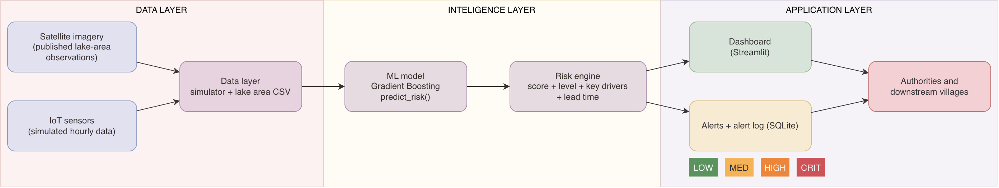
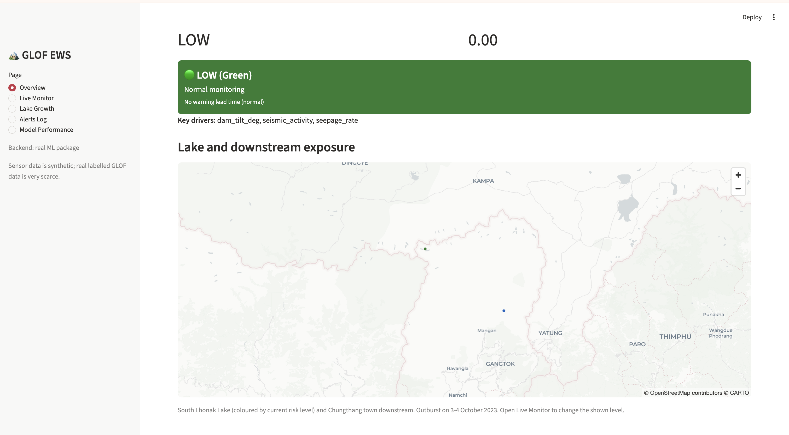
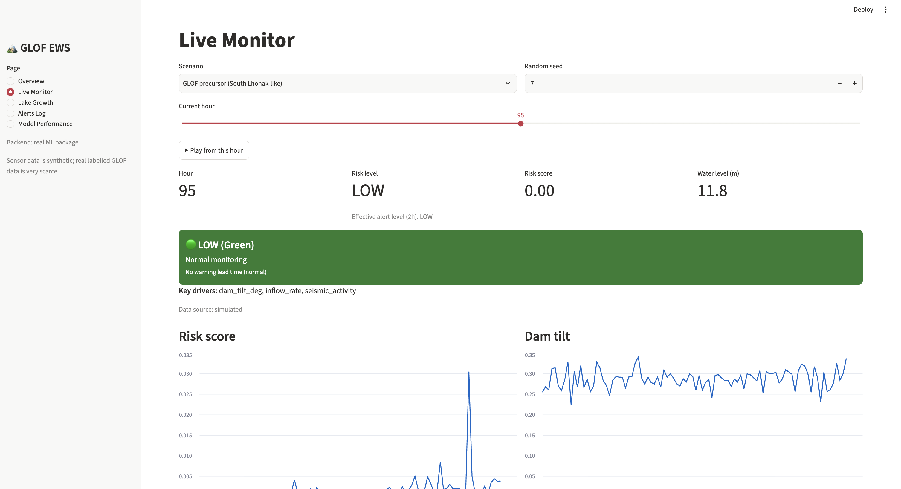
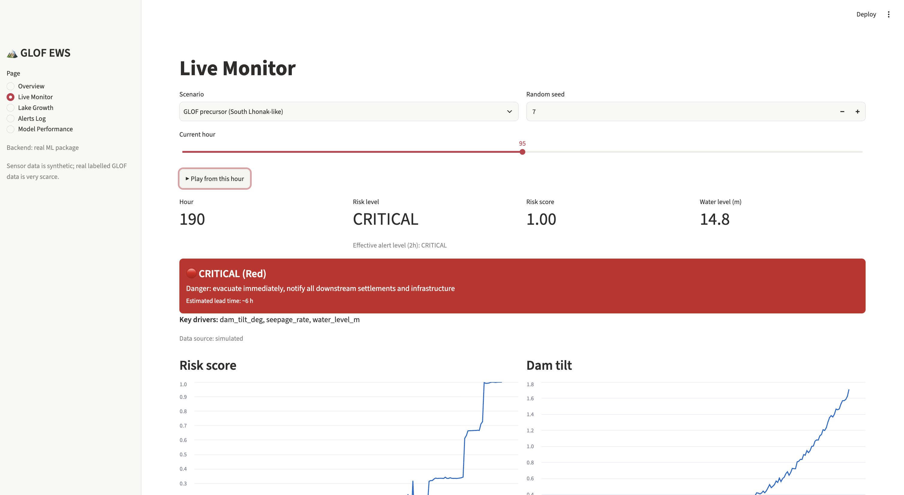
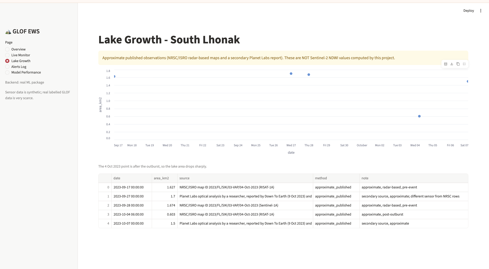
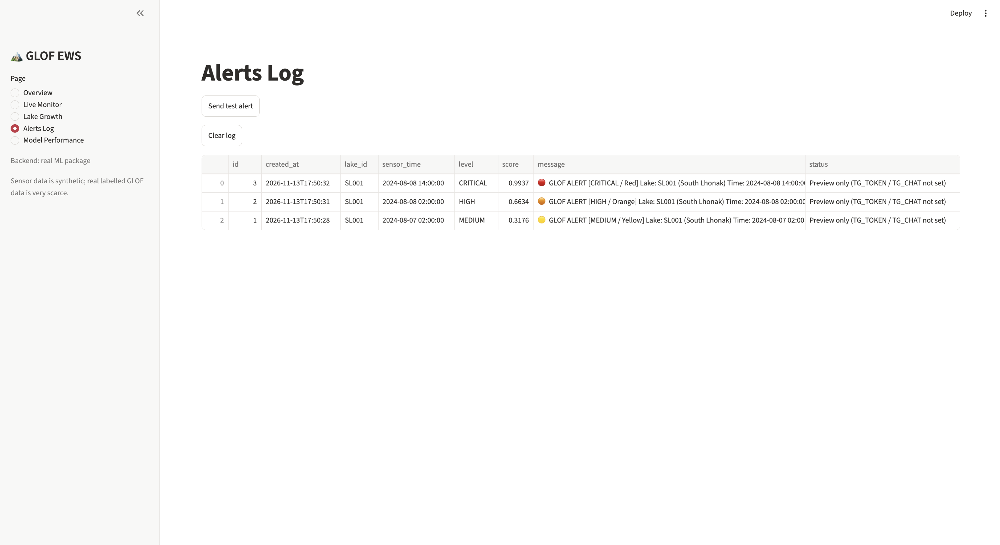
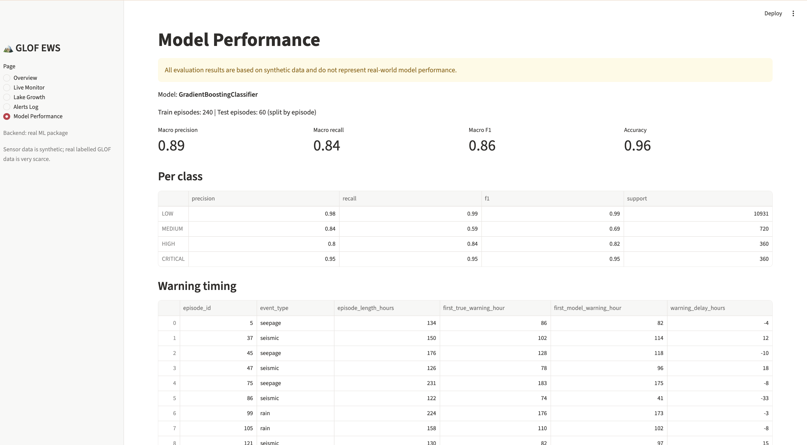

# GLOF Early Warning System: Project Report

---

## 1. Problem Statement and Objectives

### 1.1 Problem
A Glacial Lake Outburst Flood (GLOF) happens when the natural dam (moraine or ice) holding a glacial lake fails and a large volume of water is released suddenly. The flood travels down the valley and can destroy settlements, roads, bridges and hydropower infrastructure. Climate change is increasing the number and size of glacial lakes, so the risk is growing.

This project addresses the problem statement from the Ministry of Defence, DGRE (DRDO), 2024 (Domain: Disaster Management, Category: Software). The statement asks for a remote-sensing and/or sensor-based Early Warning System (EWS) that monitors lake size, water level, temperature, sudden water flow, dam stability and ground movement, and uses machine learning to detect early signs of an outburst.

### 1.2 Our approach
We built a software prototype, which is the "predictive model" option of the problem statement. No physical hardware is part of this project. The prototype:

- generates simulated hourly IoT sensor data, including GLOF precursor scenarios;
- uses approximate published lake-area observations for the case-study lake;
- trains a machine learning model that outputs a risk score, a risk level (LOW, MEDIUM, HIGH, CRITICAL), the key contributing factors and an estimated lead time;
- presents the results on a dashboard and raises colour-coded alerts.

The case study is South Lhonak Lake, North Sikkim, which burst on the night of 3-4 October 2023. The flood travelled down the Teesta valley and damaged the Chungthang (Teesta III) dam.

### 1.3 Objectives
1. Detect early signs of a GLOF from multiple sensor signals.
2. Convert the model output into four clear, colour-coded risk levels.
3. Explain each prediction by showing its key drivers.
4. Give authorities an estimated lead time to prepare evacuation.
5. Provide a dashboard and an alert mechanism that a control room could use.

---

## 2. System Architecture

*Figure 1: System architecture.*

The system has three layers.

| Layer | Components | Owner |
|---|---|---|
| Data layer | Sensor simulator, lake-area observations (CSV) | Member A |
| Intelligence layer | Training, saved model, `predict_risk()`, evaluation | Member A |
| Application layer | Streamlit dashboard, alert logic, alert log (SQLite), optional REST API | Member B |

### 2.1 Interface between the layers
The two parts of the project connect through a fixed interface contract of three functions:

- `predict_risk(reading, history)` returns the risk score, risk level, level index, top factors and estimated lead time;
- `simulate_episode(scenario, seed, hours)` returns an hourly sensor DataFrame, used for the live demo playback;
- `get_lake_area_series()` returns the lake-area observations.

Each reading contains eight sensor fields: water level, seepage rate, dam tilt, inflow rate, seismic activity, rainfall, water temperature and lake area. The model also uses the 6-hour change of water level, seepage and tilt, so the application passes the previous readings (oldest first) as `history`.

### 2.2 Why this design
Because the application layer depends only on the contract, the dashboard could be developed against stand-in stub functions and then connected to the real model without code changes. It also means a real IoT gateway could replace the simulator later.

---

## 3. Implementation

### 3.1 Technology
Python 3.12, Streamlit (dashboard), pandas and NumPy (data handling), scikit-learn and joblib (model, from Part A), SQLite (alert log), requests (alert delivery), optional FastAPI.

### 3.2 Dashboard
The dashboard (`app/dashboard.py`) has five pages.

| Page | Content |
|---|---|
| Overview | Map of South Lhonak Lake and Chungthang town, current risk level in its colour, risk score and key drivers |
| Live Monitor | Choice of scenario (GLOF precursor or normal) and random seed, hour slider with a play button, charts of all sensors, risk score over time, key drivers, estimated lead time |
| Lake Growth | Lake-area observations with a clear note on their source |
| Alerts Log | Table of every alert raised, with time, level, score and delivery status |
| Model Performance | Evaluation metrics, per-class results and figures supplied by Part A |

Design choices that support the control-room use case:

- the same four colours are used everywhere for the risk level;
- the "Key drivers" next to each level show which sensor signals contributed most, which supports explainability;
- every sensor chart is labelled "Data source: simulated";
- the play button advances the simulated hours so that the escalation of a GLOF can be watched as it would unfold.

### 3.3 Live demonstration method
For each simulated hour, the dashboard sends the current reading and up to 12 previous readings to `predict_risk`. This is required because the model uses 6-hour changes; without history those features would be zero and the risk would stay low.

---

## 4. Alert Logic and Levels

### 4.1 Levels and actions

| Level | Colour | Action message |
|---|---|---|
| LOW | Green | Normal monitoring |
| MEDIUM | Yellow | Watch: increase monitoring frequency, notify control room |
| HIGH | Orange | Warning: alert authorities, prepare evacuation of downstream villages |
| CRITICAL | Red | Danger: evacuate immediately, notify all downstream settlements and infrastructure |

### 4.2 Avoiding repeated alerts
Sending an alert every hour would cause alert fatigue. The rule implemented in `app/alerts.py` is:

1. no alert is raised at LOW;
2. an alert is raised when the level increases (for example LOW to MEDIUM, or HIGH to CRITICAL);
3. while the level stays at HIGH or CRITICAL, the alert is repeated every 12 hours;
4. if the level falls, the memory is reset so that a later escalation raises a new alert.

### 4.3 Alert content and storage
Each alert message contains the level and colour, lake, time, risk score, key drivers, estimated lead time and the recommended action. Every alert is stored in a SQLite database (`app/alerts.db`) and shown on the Alerts Log page. The alert text can be delivered through [PLACEHOLDER: state exactly which channels you demonstrated, for example Telegram, email or push notification]. The code supports Telegram through the Bot API; channels that are not configured are skipped and reported as "preview only".

[PLACEHOLDER: insert screenshot of an alert message on a phone, if available]

---

## 5. Deployment and Scalability

The prototype runs on a single machine. For a real deployment:

- **Sensors:** field sensors at the lake would send readings to a gateway. The optional REST API (`POST /predict`) is designed as this integration point. [PLACEHOLDER: keep this sentence only if you built `app/api.py`.]
- **Multiple lakes:** every reading carries a `lake_id`, so additional lakes can be added by monitoring each identifier separately.
- **Hosting:** the dashboard can be hosted on a central server for the control room, and the alert log moved from SQLite to a server database.
- **Connectivity:** remote lakes often have poor connectivity. Edge processing at the lake and satellite or radio links would be needed. This is future work.

---

## 6. Downstream Exposure

A GLOF affects everything along the flood path. For the case study, the dashboard marks South Lhonak Lake and Chungthang town on the map. In the 2023 event the flood damaged the Chungthang (Teesta III) hydropower dam and caused widespread loss downstream. [VERIFY with a published source before submission.]

A full deployment would map the following exposed elements along the valley and attach them to the alert levels:

- villages and towns;
- roads and bridges;
- hydropower projects;
- defence assets and border infrastructure.

[PLACEHOLDER: add real names and locations only from published sources. The prototype only marks two points (the lake and Chungthang) and does not include a flood-routing model.]

---

## 7. Limitations (application side)

- The sensor data is **simulated**, because real labelled GLOF sensor data is extremely scarce. The dashboard therefore demonstrates the method, not field performance.
- The alert rule (repeat every 12 hours, MEDIUM and above) is a design choice and has not been tuned on real operations.
- Alerts have only been tested in the demo setting. Real delivery needs redundant channels and acknowledgement by recipients.
- The map shows two points and no flood path, depth or travel time.

---

## 8. Future Work

- Deploy with real sensors and field gateways, and train on real sensor data.
- Add Sentinel-1 SAR (works through cloud) and optical Sentinel-2 NDWI to track lake area on a regular schedule.
- Add DEM-based flood routing, so that alerts include arrival time and inundation for each downstream settlement.
- Run the model on edge devices at the lake.
- Add redundant alert channels (SMS, sirens, radio) and recipient acknowledgement.

---

## 9. Conclusion

We built a working early warning prototype that connects a machine learning risk model to a dashboard and a colour-coded alert system, using a fixed interface so the model and the application could be built in parallel. The system shows the risk level, the key drivers and an estimated lead time, and raises non-repetitive alerts as a simulated GLOF develops. Its main limitation is the use of simulated sensor data, which should be replaced with real field data before any operational use.
