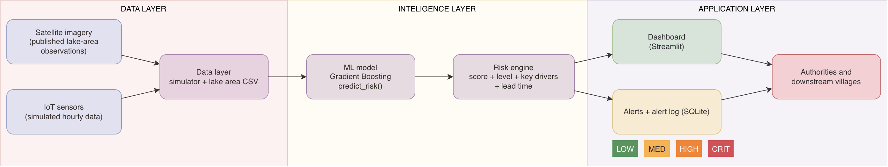
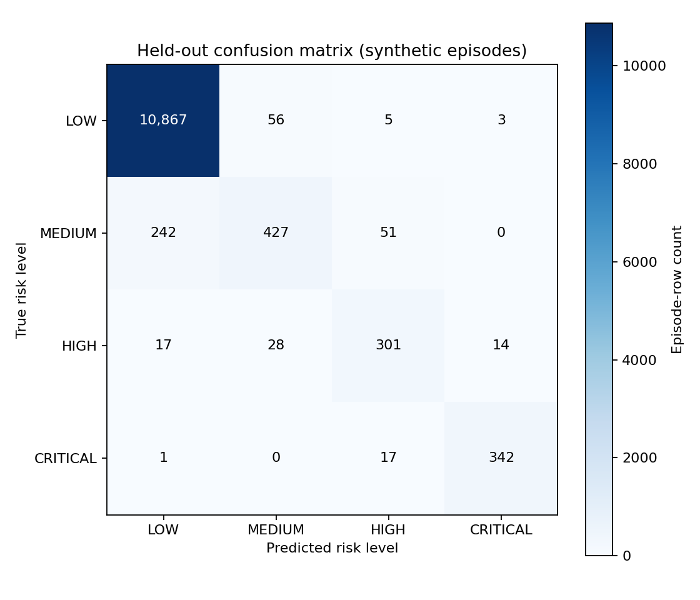
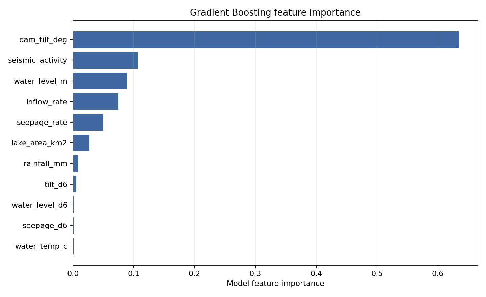
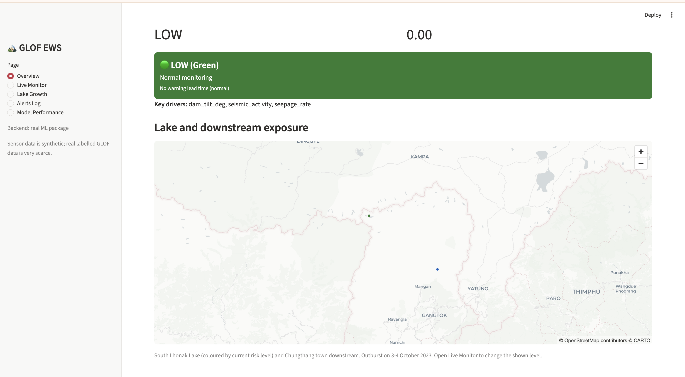
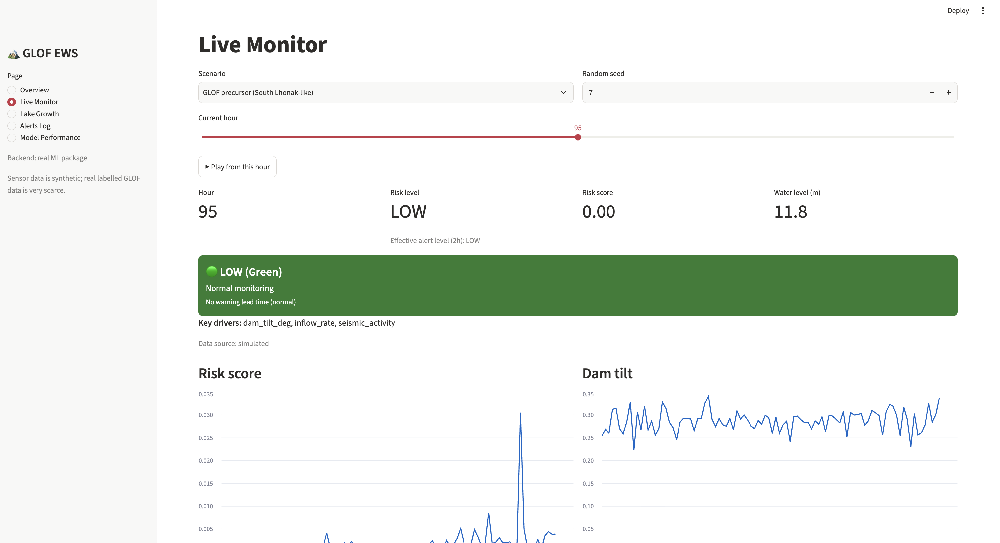
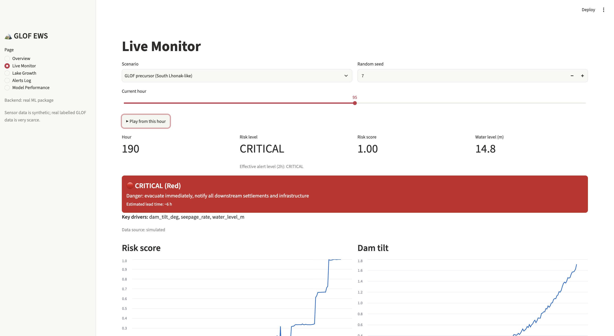
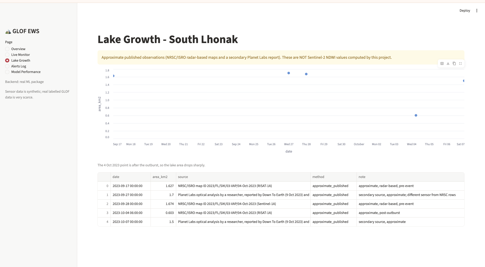
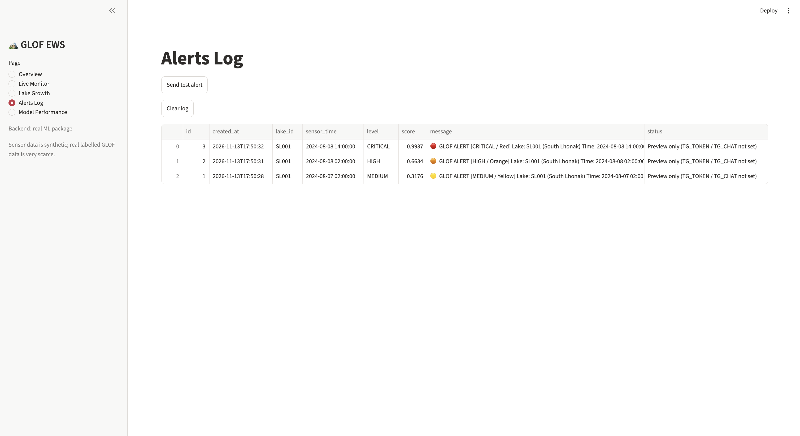
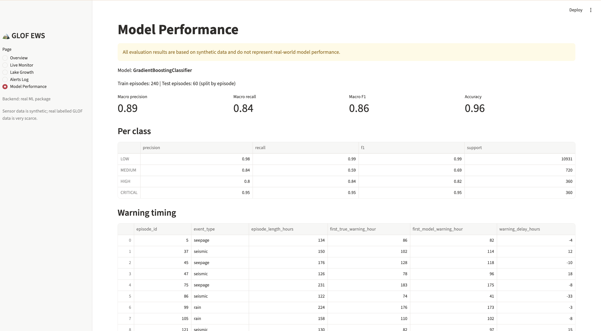
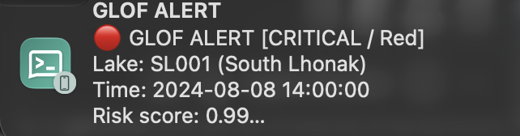

# GLOF Early Warning System: Project Report

**Machine-learning risk scoring, dashboard and alerts for glacial lake outburst floods**
Case study: South Lhonak Lake, Sikkim

**Team:** Harshyamsinh Jadeja and Saransh Mittal
**Problem source:** Ministry of Defence, DGRE (DRDO), 2024. Domain: Disaster Management. Category: Software.
**Submission date:** 15 November 2026

---

## Abstract

Glacial Lake Outburst Floods (GLOFs) release large volumes of water without much notice and can destroy settlements and infrastructure far downstream. This project builds a software early warning prototype for the case-study lake, South Lhonak Lake in Sikkim, India. Because real labelled GLOF sensor data is extremely scarce, a simulator generates hourly sensor episodes (normal conditions and rain-, seepage- and seismic-triggered outbursts). A Gradient Boosting classifier trained on 240 episodes assigns one of four risk levels (LOW, MEDIUM, HIGH, CRITICAL) with a risk score and key drivers. A Streamlit dashboard shows the live risk, sensor charts, lake-area observations and an alert log, and a colour-coded alert system sends push notifications to a phone.

On 60 held-out simulated episodes the model reaches a macro F1 of 0.86. With the dashboard's two-hour persistence rule, all 30 simulated outbursts were warned a median of 46 hours (shortest 20 hours) before the event, the first HIGH level came a median of 22 hours (shortest 18 hours) before it, and the 30 normal episodes produced no false alerts. **All results come from simulated data and do not demonstrate real-world performance.** The lake-area values are approximate published observations, not Sentinel-2 NDWI values computed by this project.

---

## 1. Introduction, Problem Statement and Objectives

### 1.1 Problem
A Glacial Lake Outburst Flood (GLOF) happens when the natural dam (moraine or ice) holding a glacial lake fails and a large volume of water is released suddenly. The flood travels down the valley and can destroy settlements, roads, bridges and hydropower infrastructure. Climate change is increasing the number and size of glacial lakes, so the risk is growing.

This project addresses the problem statement from the Ministry of Defence, DGRE (DRDO), 2024. The statement asks for a remote-sensing and/or sensor-based Early Warning System (EWS) that monitors lake size, water level, temperature, sudden water flow, dam stability and ground movement, and uses machine learning to detect early signs of an outburst.

### 1.2 Case study
South Lhonak Lake lies at about 5,200 m above sea level in the Upper Teesta basin of Sikkim and is one of the largest and fastest-growing lakes in the region. On 3 October 2023 about 14.7 million m³ of frozen lateral moraine collapsed into the lake, generating a tsunami-like wave of roughly 20 m that breached the moraine dam and drained about 50 million m³ of water. The resulting flood cascade killed 55 people, left 74 missing, and destroyed the 1,200 MW Teesta-III hydropower dam at Chungthang (Sattar et al., 2025). The flood reached Chungthang shortly after midnight on 4 October and affected Sikkim and West Bengal, with transboundary effects in Bangladesh.

### 1.3 Our approach
We built a software prototype, which is the "predictive model" option of the problem statement. No physical hardware is part of this project. The prototype:

- generates simulated hourly IoT sensor data, including GLOF precursor scenarios;
- uses approximate published lake-area observations for the case-study lake;
- trains a machine learning model that outputs a risk score, a risk level (LOW, MEDIUM, HIGH, CRITICAL), the key contributing factors and an estimated lead time;
- presents the results on a dashboard and raises colour-coded alerts.

### 1.4 Objectives
1. Detect early signs of a GLOF from multiple sensor signals.
2. Convert the model output into four clear, colour-coded risk levels.
3. Explain each prediction by showing its key drivers.
4. Give authorities an estimated lead time to prepare evacuation.
5. Provide a dashboard and an alert mechanism that a control room could use.

---

## 2. Literature Review

### 2.1 How GLOFs happen
GLOFs occur when lakes fed by retreating glaciers breach the moraine or ice dam that holds them. The breach is often set off by a trigger. The literature on Himalayan events shows several:

- **Mass collapse into the lake.** At South Lhonak in 2023, the collapse of about 14.7 million m³ of frozen moraine into the lake generated an impact wave that breached the dam (Sattar et al., 2025).
- **Heavy rainfall and snowmelt.** At Kedarnath in June 2013, heavy rainfall and rapid snowmelt over a small seasonal lake led to a lake outburst and debris flow that caused the vast majority of the deaths in the Uttarakhand floods of that month (Allen et al., 2016).
- **Rock and ice avalanches.** The 2021 Chamoli disaster was caused by about 27 million m³ of rock and glacier ice collapsing from Ronti Peak into a mobile debris flow. It is not a lake outburst in the strict sense, but it shows how mass movements in glaciated terrain can produce sudden floods with little warning (Shugar et al., 2021).

Seepage through the dam and earthquakes are also commonly discussed in the GLOF literature as causes of dam weakening or failure. Our simulator therefore includes three outburst types: rain-triggered, seepage-triggered and seismic-triggered (Chapter 4).

### 2.2 Scale of the hazard
A global compilation of glacier outburst floods recorded 1,348 floods from 332 sites, with societal impacts at 36% of those sites and more than 12,000 deaths in total (Carrivick and Tweed, 2016). A global assessment of GLOF threat to people found that High Mountain Asia has the highest potential for GLOF impacts, and highlighted the Andes as another region of concern (Taylor et al., 2023). Together these studies show that the hazard is widespread and that exposure is growing.

### 2.3 The South Lhonak event and the need for warning
The reconstruction of the 2023 event used high-resolution satellite imagery and modelling, and described the outburst as a multihazard cascade: moraine collapse, impact wave, dam breach, flood, and then sediment erosion and debris flows along the Teesta valley (Sattar et al., 2025). The authors highlight the need for early warning systems, for risk management and mitigation, and for assessment of the risks to the growing number of hydropower schemes in the region.

### 2.4 Monitoring approaches and the gap this project addresses
Two kinds of signal are relevant to a lake early warning system. The first is slow change observed from space, for example lake area growth in satellite imagery, which identifies lakes that are becoming dangerous. The second is fast change measured on site, such as water level, seepage, dam movement, inflow, rainfall and ground vibration, which can show a dam approaching failure over hours to days.

Real labelled sensor records from past outbursts are extremely scarce, so a machine learning model for the second kind of signal cannot currently be trained and validated on real data. This project therefore demonstrates the full chain (sensor readings, risk model, explanation, dashboard and alert) on simulated sensor episodes, combined with published satellite-derived lake-area observations for the case-study lake. It is a prototype of the method, not a validated warning service.

---

## 3. System Architecture

*Figure 1: System architecture.*

The system has three layers.

| Layer | Components |
|---|---|
| Data layer | Sensor simulator, lake-area observations (CSV) |
| Intelligence layer | Training, saved model, `predict_risk()`, evaluation |
| Application layer | Streamlit dashboard, alert logic, alert log (SQLite), push notifications |

### 3.1 Interface between the layers
The data and intelligence layers connect to the application layer through a fixed interface of three functions:

- `predict_risk(reading, history)` returns the risk score, risk level, level index, top factors and estimated lead time;
- `simulate_episode(scenario, seed, hours)` returns an hourly sensor DataFrame, used for the live demo playback;
- `get_lake_area_series()` returns the lake-area observations.

Each reading contains eight sensor fields: water level, seepage rate, dam tilt, inflow rate, seismic activity, rainfall, water temperature and lake area. The model also uses the six-hour change of water level, seepage and tilt, so the application passes the previous readings (oldest first) as `history`.

### 3.2 Why this design
Because the application layer depends only on this interface, the dashboard could be developed against stand-in stub functions and then connected to the real model without code changes. When any stub is used, the dashboard shows a warning that the outputs are not model predictions. The same interface means that a real sensor gateway could replace the simulator later.

---

## 4. Data

### 4.1 Why simulated sensor data
Real labelled GLOF sensor data is extremely scarce, so sensor readings are simulated. The results therefore measure how well the model learns the simulator's patterns. They do not establish real-world performance.

### 4.2 The simulator
`ml/simulator.py` generates hourly episodes for two scenarios:

- **Normal:** baseline sensor readings with per-episode offsets and noise. For each sensor the generator may add a sparse missing value or an implausible spike as a false-alarm trap.
- **GLOF:** a generated precursor and outburst with one of three event types: **rain**, **seepage** or **seismic**. The event type is stored in each episode's `event_type` column.

Each row has eight sensor fields: `water_level_m`, `seepage_rate`, `dam_tilt_deg`, `inflow_rate`, `seismic_activity`, `rainfall_mm`, `water_temp_c` and `lake_area_km2`.

### 4.3 Labels
For GLOF episodes the simulator assigns a label from the time remaining to the event: label 0 (LOW) before the 48-hour window; label 1 (MEDIUM) when fewer than 48 hours remain; label 2 (HIGH) when fewer than 24 hours remain; and label 3 (CRITICAL) when fewer than 12 hours remain. Each GLOF episode ends at its simulated outburst row.

Seismic episodes have a weak, gradual seismic, tilt and water-level precursor beginning about 48 hours before the event. The stronger, sudden seismic trigger starts about 10 hours before the event, with a fast hydrological rise. This gap between the weak precursor and the strong trigger explains the low MEDIUM recall for seismic events reported in Chapter 7.

### 4.4 Train and test split
The dataset has 300 episodes. They are split by episode, not by row, in a stratified 80/20 split: 240 training episodes (50,874 rows) and 60 held-out test episodes (12,371 rows). Splitting by episode keeps the correlated hourly rows of one episode together and avoids leakage between training and testing.

### 4.5 Lake-area observations
`ml/lake_area.py` loads the CSV for the dashboard's Lake Growth page. These are **approximate published values, not measurements computed from Sentinel-2 NDWI by this project.** The three NRSC/ISRO entries are radar-based. The two Planet Labs entries are a secondary optical analysis reported by Down To Earth and the EGU Cryospheric blog. Radar and optical measurements are not directly comparable.

| Date | Area (km²) | Source and note |
|---|---:|---|
| 2023-09-17 | 1.627 | NRSC/ISRO map 2023/FL/SIK/03-VAP/04-Oct-2023, RISAT-1A; radar-based, pre-event |
| 2023-09-27 | 1.700 | Planet Labs optical analysis (secondary report); approximate |
| 2023-09-28 | 1.674 | NRSC/ISRO map, Sentinel-1A; radar-based, pre-event |
| 2023-10-04 | 0.603 | NRSC/ISRO map, RISAT-1A; post-outburst |
| 2023-10-07 | 1.500 | Planet Labs optical analysis (secondary report); approximate |

The two post-outburst values (0.603 km² on 4 October and 1.5 km² on 7 October) differ substantially. This shows the uncertainty of these approximate, secondary values, and is one reason they are shown only for context and not used to train the model. An Earth Engine script for Sentinel-2 NDWI extraction (`data/extract_lake_area.py`) exists only as an untested skeleton and has contributed no values.

---

## 5. Machine Learning Methodology

### 5.1 Features and model
The model uses the eight sensor fields plus three within-episode six-hour changes.

| Feature group | Features |
|---|---|
| Sensor readings | `water_level_m`, `seepage_rate`, `dam_tilt_deg`, `inflow_rate`, `seismic_activity`, `rainfall_mm`, `water_temp_c`, `lake_area_km2` |
| Six-hour changes | `water_level_d6`, `seepage_d6`, `tilt_d6` |

`ml/train.py` builds the change features within each episode and fills missing feature values with a median imputer fitted on the training rows. The classifier is a scikit-learn `GradientBoostingClassifier`, which predicts one of four levels.

### 5.2 Risk score, level and explanation
`predict_risk(reading, history=None)` returns:

- `risk_score`: a probability-based float from 0 to 1;
- `risk_level`: LOW, MEDIUM, HIGH or CRITICAL, with `level_index` 0 to 3;
- `top_factors`: the three features that contribute most to the prediction, which the dashboard shows as "Key drivers";
- `estimated_lead_time_hrs`: a fixed per-level approximation (MEDIUM 36 h, HIGH 18 h, CRITICAL 6 h, LOW none). It is not separately predicted by the model.

`history` may be an oldest-first list of earlier readings or a pandas DataFrame. With fewer than six earlier rows, the three six-hour change features default to zero.

### 5.3 Evaluation and lead-time metric
Per-class precision and recall, the confusion matrix and feature importance are computed on the held-out test episodes. For each held-out GLOF episode, warning timing compares the first model warning with the first true warning label, and the lead time is the outburst hour minus the hour of the first warning. The share of normal-episode rows predicted above LOW measures false alarms.

### 5.4 Prediction checks
The interface is tested with `python -m ml.check_contract` (field names, types, ranges, history handling, missing and invalid input, and a monotonic GLOF check), and the alert logic with `python -m app.check_alert_logic`. `bash check_all.sh` runs all checks together.

---

## 6. Implementation: Dashboard and Alerts

### 6.1 Technology
Python 3.12, Streamlit 1.67.0 (dashboard), pandas 2.3.3 and NumPy 2.4.2 (data handling), scikit-learn 1.8.0 and joblib 1.5.3 (model), SQLite (alert log), requests (alert delivery) and matplotlib (evaluation plots). Versions are pinned in `requirements.txt`.

### 6.2 Dashboard
The dashboard (`app/dashboard.py`) has five pages. Screenshots are in Chapter 7.

| Page | Content |
|---|---|
| Overview | Map of South Lhonak Lake and Chungthang town, current risk level in its colour, risk score and key drivers |
| Live Monitor | Choice of scenario (GLOF precursor or normal) and random seed, hour slider with a play button, charts of all sensors, risk score over time, key drivers, estimated lead time |
| Lake Growth | Lake-area observations with a clear note on their source |
| Alerts Log | Table of every alert raised, with time, level, score and delivery status |
| Model Performance | Evaluation metrics, per-class results and figures |

Design choices that support the control-room use case:

- the same four colours are used everywhere for the risk level;
- the "Key drivers" next to each level show which sensor signals contributed most, which supports explainability;
- every sensor chart is labelled "Data source: simulated";
- the play button advances the simulated hours so that the escalation of a GLOF can be watched as it unfolds.

### 6.3 Live demonstration method
For each simulated hour, the dashboard sends the current reading and up to 12 previous readings to `predict_risk`. This is required because the model uses six-hour changes; without history those features would be zero and the risk would stay low.

### 6.4 Alert levels and actions

| Level | Colour | Action message |
|---|---|---|
| LOW | Green | Normal monitoring |
| MEDIUM | Yellow | Watch: increase monitoring frequency, notify control room |
| HIGH | Orange | Warning: alert authorities, prepare evacuation of downstream villages |
| CRITICAL | Red | Danger: evacuate immediately, notify all downstream settlements and infrastructure |

### 6.5 Alert logic: persistence and repeat control
Sending an alert for every noisy reading would cause alert fatigue, and the evaluation showed that some first warnings come from single-row blips. The rule in `app/alerts.py` therefore works in two steps.

1. **Persistence.** At each hour the effective alert level is the minimum of the predicted levels over the last two hours (`PERSISTENCE_HOURS = 2`; fewer rows are used at the start of an episode). A single-hour blip therefore does not raise an alert.
2. **Alert rules.** No alert is raised at LOW. An alert is raised when the effective level rises above the remembered alert level (for example LOW to MEDIUM, or HIGH to CRITICAL). While the level stays at HIGH or CRITICAL, the alert is repeated every 12 hours. If the level falls, the remembered level steps down so that a later escalation raises a new alert.

The persistence study in Chapter 7 shows why a window of two hours was chosen as the default.

### 6.6 Alert content, delivery and storage
Each alert message contains the level and colour, lake, time, risk score, key drivers, estimated lead time and the recommended action. Every alert is stored in a SQLite database (`app/alerts.db`) and shown on the Alerts Log page. The alert text can be delivered through three channels: ntfy push notifications, Telegram (Bot API) and Discord (webhook). Channels that are not configured are skipped and reported as "preview only". Push delivery through ntfy was tested on a phone (Figure 10); the Telegram and Discord channels are implemented but were not demonstrated.

### 6.7 Deployment and scalability
The prototype runs on a single machine. For a real deployment:

- **Sensors:** field sensors at the lake would send readings to a gateway. A web service wrapping `predict_risk` would be the natural integration point; it is not implemented in this prototype.
- **Multiple lakes:** every reading carries a `lake_id`, so additional lakes can be added by monitoring each identifier separately.
- **Hosting:** the dashboard can be hosted on a central server for the control room, and the alert log moved from SQLite to a server database.
- **Connectivity:** remote lakes often have poor connectivity, so edge processing at the lake and satellite or radio links would be needed. This is future work.

### 6.8 Downstream exposure
A GLOF affects everything along the flood path. For the case study, the dashboard marks South Lhonak Lake and Chungthang town on the map. In 2023 the flood destroyed the Teesta-III hydropower dam at Chungthang, impacted Sikkim and West Bengal, and had transboundary implications in Bangladesh (Sattar et al., 2025).

A full deployment would map the following exposed elements along the valley and attach them to the alert levels:

- villages and towns;
- roads and bridges;
- hydropower projects;
- defence assets and border infrastructure.

---

## 7. Results and the South Lhonak Case Study

All results in this chapter use the held-out simulated episodes and the saved files in `ml/results/`.

### 7.1 Classification performance
The model was evaluated on 60 held-out test episodes (12,371 rows).

| Risk level | Precision | Recall | F1 | Test rows |
|---|---:|---:|---:|---:|
| LOW | 0.977 | 0.994 | 0.985 | 10,931 |
| MEDIUM | 0.836 | 0.593 | 0.694 | 720 |
| HIGH | 0.805 | 0.836 | 0.820 | 360 |
| CRITICAL | 0.953 | 0.950 | 0.951 | 360 |

Macro precision is 0.892, macro recall 0.843 and macro F1 0.863. Overall accuracy is 0.965.

*Figure 2: Confusion matrix on the held-out simulated episodes.*

Most counts lie on the diagonal. The largest off-diagonal error is MEDIUM rows classified as LOW.

*Figure 3: Gradient Boosting feature importance.*

Dam tilt has the largest importance by a wide margin, followed by seismic activity. The six-hour change features are near the bottom of the ranking.

### 7.2 Recall by outburst type

| Event type | LOW recall | MEDIUM recall | HIGH recall | CRITICAL recall |
|---|---:|---:|---:|---:|
| Rain | 0.982 | 0.921 | 0.833 | 0.954 |
| Seepage | 0.986 | 0.968 | 0.944 | 0.981 |
| Seismic | 0.996 | 0.066 | 0.757 | 0.924 |

Seismic events are the weakness. The seismic trigger in the simulator occurs only about 10 hours before the outburst, so the earlier MEDIUM stage is hard to recognise.

### 7.3 Warning lead time and false alarms
Across the 30 held-out simulated outbursts, every episode received a warning before the event. The mean warning delay relative to the first true warning label is −7.4 hours (negative means the model warned before the label); the worst late delay is 26 hours. The warning was late in 1 of 9 rain episodes, 0 of 9 seepage episodes and 9 of 12 seismic episodes (late by 12 to 26 hours).

Without a persistence filter, the first alert came a median of 50 hours before the outburst. By event type the median and shortest lead times were 52 and 43 hours for rain, 51 and 47 hours for seepage, and about 33 and 21 hours for seismic events.

False alarms were measured on the 30 held-out normal episodes: 21 of 7,200 rows (0.29%) were predicted above LOW.

### 7.4 Effect of the persistence window
The table shows the alert study over the same held-out episodes. False alerts are the total number of alerts on the 30 normal episodes. GLOF episodes alerted counts episodes with at least one alert before the event. Lead times are for the first such alert.

| Window k (hours) | False alerts on normal episodes | GLOF episodes alerted | First alert lead: median / minimum | First HIGH lead: median / minimum |
|---:|---:|---:|---:|---:|
| 1 (no filter) | 21 | 30/30 | 50 / 21 h | 24 / 20 h |
| **2 (default)** | **0** | **30/30** | **46 / 20 h** | **22 / 18 h** |
| 3 | 0 | 30/30 | 43.5 / 17 h | 21 / 12 h |
| 4 | 0 | 30/30 | 41.5 / 16 h | 20 / 9 h |

The default window of two hours removed all false alerts seen without a filter, at the cost of a slightly later first alert (median 46 hours instead of 50). This is a trade-off observed on simulated data, not a validated operational setting.

### 7.5 South Lhonak case study
The case study combines three pieces of evidence.

1. **The real event.** The 2023 outburst was triggered by a large moraine collapse into a lake that had been growing for years (Sattar et al., 2025). The published lake-area observations in Section 4.5 show a lake of about 1.6 to 1.7 km² shortly before the outburst.
2. **A South Lhonak-like simulated replay.** In the Live Monitor, the GLOF scenario ramps up water level, seepage, dam tilt and inflow over the final days. The model's risk level climbs from LOW through MEDIUM and HIGH to CRITICAL, and each rise in level raises an alert (Figures 5 and 6).
3. **A phone notification.** A real CRITICAL alert from the replay reached a phone through ntfy (Figure 10).

The replay uses simulated data. It demonstrates the method and the alert chain for this lake, and does not show that the system would have predicted the real 2023 event.

### 7.6 Dashboard screenshots

*Figure 4: Overview page.*

*Figure 5: Live Monitor in the GLOF scenario at a low-risk hour.*

*Figure 6: Live Monitor in the GLOF scenario at the CRITICAL level, with key drivers and estimated lead time.*

*Figure 7: Lake Growth page with the source note.*

*Figure 8: Alerts Log.*

*Figure 9: Model Performance page.*

*Figure 10: A CRITICAL alert received on a phone through ntfy.*

---

## 8. Limitations and Future Work

### 8.1 Limitations
- **Simulated data.** All sensor readings and labels used for training and evaluation are synthetic. The model learned the simulator's rules, so held-out scores measure agreement with that simulator and may be optimistic. There is no validation against real sensor records or historical GLOFs.
- **Not an emergency service.** The prototype is not connected to a sensor feed and must not be used as an operational warning service.
- **Seismic events.** Seismic MEDIUM recall is only 0.066, and seismic warnings were late by 12 to 26 hours in 9 of 12 held-out seismic episodes.
- **Blips and persistence.** Some first-warning flags come from single-row blips. The persistence rule removed the false alerts seen in the evaluated episodes, but it has not been validated operationally and delays the first alert.
- **Lead time.** The estimated lead time shown with each level is a fixed approximation, not predicted from data.
- **Lake-area data.** The published observations are approximate, come from different sensors, disagree after the outburst, and are not a project-computed Sentinel-2 NDWI series. The secondary Planet Labs reports should be checked against their original publication.
- **Alert delivery.** Alerts were tested only in the demo setting. Real delivery needs redundant channels and acknowledgement by recipients. Only ntfy was demonstrated.
- **Map.** The map shows two points and no flood path, depth or travel time.

### 8.2 Future work
- Validate the approach on real sensor records and historical GLOF events when suitable data are available, and train on real sensor data.
- Implement and verify Sentinel-2 NDWI extraction in Google Earth Engine, and add Sentinel-1 SAR, which works through cloud, to track lake area on a regular schedule.
- Improve the weak simulated seismic precursor using better-supported precursor information.
- Calibrate predicted probabilities using suitable independent data.
- Add DEM-based flood routing, so that alerts include arrival time and inundation for each downstream settlement.
- Run the model on edge devices at the lake, and add redundant alert channels (SMS, sirens, radio) with recipient acknowledgement.

---

## 9. Conclusion

We built a working early warning prototype that connects a machine learning risk model to a dashboard and a colour-coded alert system, using a fixed interface so that the model and the application could be developed in parallel. On simulated episodes the model reaches a macro F1 of 0.86, and with a two-hour persistence rule it warned all 30 simulated outbursts, a median of 46 hours before the event, while producing no false alerts on 30 normal episodes. The system shows the risk level, the key drivers and an estimated lead time, and sends non-repetitive alerts to a phone as a simulated GLOF develops.

Its main limitation is the use of simulated sensor data. Before any operational use, the model must be trained and validated on real field data, and the system extended with satellite monitoring and flood routing.

---

## References

Allen, S. K., Rastner, P., Arora, M., Huggel, C., and Stoffel, M. (2016). Lake outburst and debris flow disaster at Kedarnath, June 2013: hydrometeorological triggering and topographic predisposition. *Landslides*, 13, 1479-1491. https://doi.org/10.1007/s10346-015-0584-3

Carrivick, J. L., and Tweed, F. S. (2016). A global assessment of the societal impacts of glacier outburst floods. *Global and Planetary Change*, 144, 1-16. https://doi.org/10.1016/j.gloplacha.2016.07.001

Sattar, A., Cook, K. L., Rai, S. K., Berthier, E., Allen, S., Rinzin, S., et al. (2025). The Sikkim flood of October 2023: Drivers, causes and impacts of a multihazard cascade. *Science*. https://doi.org/10.1126/science.ads2659

Shugar, D. H., Jacquemart, M., Shean, D., et al. (2021). A massive rock and ice avalanche caused the 2021 disaster at Chamoli, Indian Himalaya. *Science*. https://doi.org/10.1126/science.abh4455

Taylor, C., et al. (2023). Glacial lake outburst floods threaten millions globally. *Nature Communications*. https://doi.org/10.1038/s41467-023-36033-x

**Lake-area data sources (secondary, approximate):**

NRSC/ISRO. Flood-extent map ID 2023/FL/SIK/03-VAP/04-Oct-2023 (RISAT-1A and Sentinel-1A observations of South Lhonak Lake).

Down To Earth (9 October 2023) and the EGU Cryospheric blog (2 November 2023), reporting a Planet Labs optical analysis of South Lhonak Lake.
